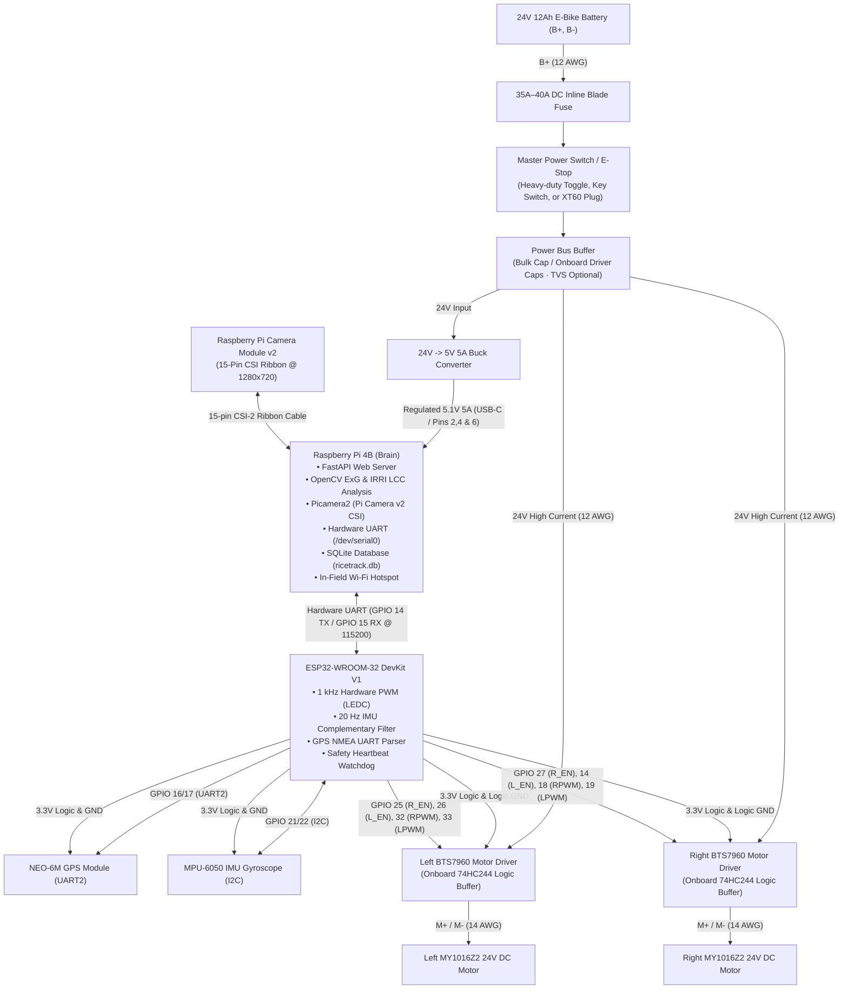

# RiceTrackCV — Raspberry Pi 4B + ESP32 Agricultural Rover

Autonomous rice field health monitoring and rover control system powered by a **Raspberry Pi 4B** (High-Level Brain, Computer Vision & Web Server) and an **ESP32-WROOM-32** (Real-Time Motor PWM & Sensor Controller), equipped with a **Raspberry Pi Camera Module v2** (15-Pin CSI Ribbon), **Direct Hardware UART Serial Bridge**, **NEO-6M GPS Module**, **MPU-6050 6-Axis IMU**, **Dual BTS7960 Motor Drivers**, **Dual MY1016Z2 24V DC Motors**, and a **24V 12Ah Ebike Battery** with a **24V → 5V Buck Converter**.

---

## 1. System Architecture (Raspberry Pi 4B + ESP32)



---

## 2. Complete Pinout & Wiring Specification

### A. Power & Ground Distribution (Star Grounding)
* **Main Traction Rail:** Battery (+) $\to$ 35A/40A Blade Fuse $\to$ Master Switch / XT60 Disconnect $\to$ Parallel branch to BTS7960 `B+` (Left & Right) and Buck Converter `In+`.
* **Buck Converter (24V $\to$ 5.1V 5A):** Supplies clean DC power to Raspberry Pi 4B (via USB-C or GPIO Header Pin 2/4 and GND Pin 6).
* **ESP32 Power:** Powered directly from Raspberry Pi 4B 5V Pin (Pin 2/4 $\to$ ESP32 `VIN` pin) or from the 5V buck converter.
* **Common Ground (Star Ground):** The Battery negative (`B-`), Buck Converter `In-` & `Out-`, and BTS7960 `B-` must all terminate at a heavy-gauge central star-ground terminal block to prevent motor return currents from flowing through the digital logic.

### B. Direct Hardware UART Interconnect (Raspberry Pi 4B $\leftrightarrow$ ESP32)
*Both Raspberry Pi 4B and ESP32 GPIO pins operate natively at **3.3V logic level**, so **no voltage divider or level shifter is needed**.*

| Raspberry Pi 4B Pin | Pi Signal | ESP32 Pin | ESP32 Signal | Function / Description |
| :--- | :--- | :--- | :--- | :--- |
| **Pin 8 (GPIO 14)** | `TXD0` | **Pin `RX0` (GPIO 3)** | `RX0` | Pi transmits JSON commands to ESP32 |
| **Pin 10 (GPIO 15)**| `RXD0` | **Pin `TX0` (GPIO 1)** | `TX0` | Pi receives telemetry/IMU/GPS from ESP32 |
| **Pin 6** | `GND` | **Pin `GND`** | `GND` | Common reference logic ground |
| **Pin 2 or 4** (Optional)| `5V` | **Pin `VIN`** | `5V In` | ESP32 power (if not powered externally) |

> [!IMPORTANT]
> **Disable Linux Serial Console:** Raspberry Pi OS binds a serial console to `/dev/serial0` by default. You must disable the login shell and keep the hardware UART enabled using `sudo raspi-config` (handled automatically by `setup_rpi.sh`).

### C. Raspberry Pi Camera Module v2 (CSI Ribbon)
* **Interface:** Connects to the Pi 4B 15-pin CSI connector located between the micro-HDMI ports and the 3.5mm audio jack.
* **Orientation:** Pull up the plastic clip gently. Insert the ribbon with the **silver contact pins facing towards the micro-HDMI ports** (blue tape faces the USB/Ethernet ports). Press the clip back down firmly.
* **Software:** Uses `Picamera2` (`python3-picamera2`) for zero-copy BGR streaming at 1280×720 @ 25 FPS with hardware AE/AWB.

### D. Drivetrain & Sensor Connections (Direct ESP32 to BTS7960)

> [!NOTE]
> **Is It Safe Without PC817? YES!**
> The BTS7960 (IBT-2) driver module already includes an onboard **74HC244 logic buffer IC** that protects and isolates the input pins before reaching the high-power half-bridge stages. Connecting the ESP32 directly to the BTS7960 logic pins is standard, simple, and completely safe as long as the **Star Ground** and **35A/40A Fuse** rules are observed.

| Module / Component | Module Pin | Connected To | Logic / Function | Wire Gauge |
| :--- | :--- | :--- | :--- | :--- |
| **NEO-6M GPS Module** | `TX` | ESP32 `GPIO 16` (RX2) | NMEA 9600 baud GPS Telemetry | 24–26 AWG |
| **NEO-6M GPS Module** | `RX` | ESP32 `GPIO 17` (TX2) | GPS Configuration | 24–26 AWG |
| **NEO-6M GPS Module** | `VCC` / `GND` | ESP32 `3.3V` / `GND` | 3.3V Sensor Power Rail | 24–26 AWG |
| **MPU-6050 6-Axis IMU** | `SDA` | ESP32 `GPIO 21` | I2C Data (Addr `0x68`) | 24–26 AWG |
| **MPU-6050 6-Axis IMU** | `SCL` | ESP32 `GPIO 22` | I2C Clock (Addr `0x68`) | 24–26 AWG |
| **MPU-6050 6-Axis IMU** | `VCC` / `GND` | ESP32 `3.3V` / `GND` | 3.3V Sensor Power Rail | 24–26 AWG |
| **Left BTS7960 Driver** | `R_EN` / `L_EN` | ESP32 `GPIO 25` / `GPIO 26` (or tied to 3.3V) | Driver Enable (Active HIGH) | 22–24 AWG |
| **Left BTS7960 Driver** | `RPWM` / `LPWM` | ESP32 `GPIO 32` / `GPIO 33` | LEDC Hardware PWM Ch 0/1 @ 1 kHz | 22–24 AWG |
| **Left BTS7960 Driver** | `VCC` / `GND` | ESP32 `3.3V` / `GND` | Driver 3.3V Logic & Ground | 22–24 AWG |
| **Left BTS7960 Driver** | `B+` / `B-` | 24V Battery Bus (post-Switch) | High Current Traction Supply | 12–14 AWG |
| **Left BTS7960 Driver** | `M+` / `M-` | Left MY1016Z2 DC Motor | Left Drive Output | 14 AWG |
| **Right BTS7960 Driver** | `R_EN` / `L_EN` | ESP32 `GPIO 27` / `GPIO 14` (or tied to 3.3V) | Driver Enable (Active HIGH) | 22–24 AWG |
| **Right BTS7960 Driver** | `RPWM` / `LPWM` | ESP32 `GPIO 18` / `GPIO 19` | LEDC Hardware PWM Ch 2/3 @ 1 kHz | 22–24 AWG |
| **Right BTS7960 Driver** | `VCC` / `GND` | ESP32 `3.3V` / `GND` | Driver 3.3V Logic & Ground | 22–24 AWG |
| **Right BTS7960 Driver** | `B+` / `B-` | 24V Battery Bus (post-Switch) | High Current Traction Supply | 12–14 AWG |
| **Right BTS7960 Driver** | `M+` / `M-` | Right MY1016Z2 DC Motor | Right Drive Output | 14 AWG |

*(Optional: If you still wish to insert an external PC817 4-channel optocoupler, simply place it between the ESP32 PWM pins and BTS7960 RPWM/LPWM inputs).*

---

## 3. Flash ESP32 Firmware

1. Open [`esp32_firmware/ricetrack_esp32/ricetrack_esp32.ino`](file:///esp32_firmware/ricetrack_esp32/ricetrack_esp32.ino) in the Arduino IDE.
2. Select Board: **DOIT ESP32 DEVKIT V1**.
3. Select Port: **COMx** (Windows) or `/dev/ttyUSBx` (Linux).
4. Click **Upload**. (No third-party libraries needed; uses native `Wire.h` and `HardwareSerial`).

---

## 4. Raspberry Pi 4B Setup & Quickstart

### Step 1: Clone & Run Automated Setup
On your Raspberry Pi running Raspberry Pi OS (64-bit recommended):
```bash
git clone <your-repo-url>
cd robo_cam-main/robo_cam-main

# Run automated dependency installer and permission configuration
chmod +x setup_rpi.sh
./setup_rpi.sh
```

### Step 2 (Optional): Enable In-Field Wi-Fi Hotspot
If operating in remote rice fields without an existing router, configure the Pi to broadcast its own Wi-Fi AP:
```bash
chmod +x create_wifi_ap.sh
./create_wifi_ap.sh
```
* **Hotspot Name (SSID):** `RiceTrack-Rover`
* **Password:** `ricetrack123`
* **Rover IP:** `192.168.4.1`

### Step 3: Run the Web Application
```bash
chmod +x run_web.sh
./run_web.sh
```
Open **`http://<pi-ip>:8000`** (or `http://192.168.4.1:8000` if connected to hotspot) in any web browser on your phone, tablet, or laptop.

### Step 4: Auto-Start on Rover Boot (systemd service)
To have RiceTrack start automatically whenever the rover is switched on:
```bash
sudo cp ricetrack.service /etc/systemd/system/
sudo systemctl daemon-reload
sudo systemctl enable --now ricetrack.service
```

---

## 5. Crop Health Checking Pipeline

* **Algorithm:** Combines Excess Green Index ($\text{ExG} = 2G - R - B$) with calibrated HSV hue and CIELAB color space distance ($\Delta E^*$).
* **IRRI Standard:** Evaluates leaves against the official International Rice Research Institute (IRRI) 4-panel Leaf Color Chart (Panels 2, 3, 4, 5).
* **Botanical Verification:** Prevents false positives from green plastics, weeds, and synthetic objects via Canny edge density and Laplacian texture variance.
* **Storage & Export:** All snapshots, coordinates, timestamps, and health scores are saved to `ricetrack.db` and can be exported as PDF field reports directly from the web interface.

---

## 6. Semi-Autonomous Instructed Roving

The system features an **Instructed Roving Engine** that coordinates sequential waypoint movements, exact turns, and automated crop health sampling:

### A. Turn Calculation via MPU-6050
* The ESP32 continuously calibrates and integrates the $Z$-axis gyroscope ($g_z$) with a deadband filter into `yaw_deg` ($20\text{ Hz}$).
* When turning Left or Right, the skid-steer drivetrain pivots until $|\Delta \text{yaw}| \ge 90^\circ$ (with a safety timeout).

### B. Standard 4-Step Mission Routine
1. **Move 1:** Drive 5 meters forward (timed at calibrated seconds/meter), turn Right 90° using MPU-6050, steady camera for 1 second, capture & evaluate crop health.
2. **Move 2:** Drive 10 meters forward, turn Left 90° using MPU-6050, steady camera, capture & evaluate crop health.
3. **Move 3:** Drive 4 meters forward, turn Left 90° using MPU-6050, steady camera, capture & evaluate crop health.
4. **Move 4 (Final Return):** Inverted Step Retrace — Rover turns 180°, then retraces completed legs in reverse order back to the initial starting point $(0, 0)$ and restores starting orientation.

### C. Selectable Interface & Speed Calibration
* **Select-Type Mission Builder:** Choose from pre-configured presets or customize distance (1m–30m), turn direction, and sampling per step using dropdown `<select>` inputs in the Web UI.
* **Speed Factor:** Default is **3.0 seconds/meter** (configurable in Standards tab to match dry or flooded field soil).
* **Emergency Abort:** One-click abort button immediately kills motor PWM and halts the mission.
