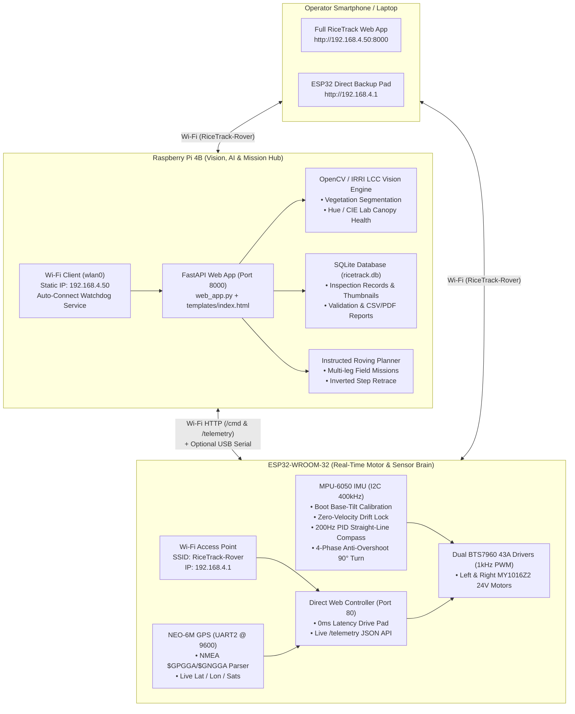

# RiceTrack Agricultural Rover — Complete System Documentation

Welcome to the **RiceTrack Rover** documentation. This guide explains the complete hardware, network, firmware, control algorithms, computer vision pipeline, and field operation workflow so any team member, operator, or future developer can understand, set up, and operate the system from scratch.

---

## 1. System Overview & Architecture

RiceTrack is a semi-autonomous agricultural rover designed for **paddy field crop health monitoring** (calibrated to **PhilRice Muñoz / IRRI 4-Panel Leaf Color Chart** standards for inbred rice such as *NSIC Rc 222 / Tubigan 18*).

It uses a **Hybrid Distributed Architecture** that separates **real-time motor & sensor control** from **high-bandwidth video streaming & AI analysis**:



### Why This Architecture?
- **Zero Motor Latency**: Motor PWM, gyro heading stabilization, and 90° precision braking run directly on the ESP32 microcontroller in C++ (~200 Hz) with zero Linux OS jitter or video-bandwidth interference.
- **No Internet Required in the Field**: The ESP32 creates its own local Wi-Fi network (`RiceTrack-Rover`). Both the Raspberry Pi (`192.168.4.50`) and the operator's smartphone connect directly to it.
- **Resilient Dual-Channel Sync**: The Raspberry Pi automatically syncs MPU-6050 and NEO-6M GPS telemetry from the ESP32 over Wi-Fi (`http://192.168.4.1/telemetry`) as well as USB Serial if connected.

---

## 2. Hardware Wiring & Pinout

### ESP32-WROOM-32 Pinout
| Subsystem | Component Pin | ESP32 GPIO | Notes |
| :--- | :--- | :--- | :--- |
| **Left BTS7960 Driver** | `RPWM` / `LPWM` | `GPIO 32` / `GPIO 33` | 1 kHz, 10-bit LEDC PWM |
| **Left BTS7960 Driver** | `R_EN` / `L_EN` | `GPIO 25` / `GPIO 26` | Driven `HIGH` to enable |
| **Right BTS7960 Driver** | `RPWM` / `LPWM` | `GPIO 18` / `GPIO 19` | 1 kHz, 10-bit LEDC PWM |
| **Right BTS7960 Driver** | `R_EN` / `L_EN` | `GPIO 27` / `GPIO 14` | Driven `HIGH` to enable |
| **MPU-6050 (IMU)** | `SDA` / `SCL` | `GPIO 21` / `GPIO 22` | 400 kHz Fast I2C (`0x68`) |
| **NEO-6M GPS** | `TX` $\rightarrow$ `RX2` | `GPIO 16` | 9600 baud NMEA input |
| **NEO-6M GPS** | `RX` $\leftarrow$ `TX2` | `GPIO 17` | 9600 baud NMEA output |
| **Status LED** | Built-in LED | `GPIO 2` | `HIGH` when motors active |

### Verified Drivetrain Polarity
| Command | Left Motor PWM | Right Motor PWM | Physical Motion |
| :--- | :--- | :--- | :--- |
| **Forward (`W` / `↑`)** | `+speed` | `+speed` | Straight forward (Gyro PID Locked) |
| **Backward (`S` / `↓`)** | `-speed` | `-speed` | Straight reverse (Gyro PID Locked) |
| **Left Turn (`A` / `←`)** | `-speed` | `+speed` | Pivot Left (Counter-Clockwise) |
| **Right Turn (`D` / `→`)** | `+speed` | `-speed` | Pivot Right (Clockwise) |
| **Release / `Space` / `▢`** | `0.0` | `0.0` | Instant Stop (Press-and-Hold Safety) |

---

## 3. Core Control Algorithms (ESP32 Firmware)

All real-time motion and sensor fusion logic lives in `esp32_firmware/ricetrack_esp32_ap_web/ricetrack_esp32_ap_web.ino`.

### A. Automatic Bootup Calibration & Zero-Velocity Drift Lock
1. **Bootup Base-Level Calibration**: On power-on, the ESP32 samples 200 full 14-byte MPU-6050 frames (with hardware 42 Hz Digital Low-Pass Filter enabled to reject motor vibration). Whatever physical angle the rover rests at becomes `0.0°` Roll and `0.0°` Pitch, and all 3 gyro biases (`gx`, `gy`, `gz`) are zeroed.
2. **Zero-Velocity Auto-Bias Tracking**: Whenever both motors are stopped (`left_duty == 0` and `right_duty == 0`) and the rover is not being spun by hand (`|gz| < 2.5°/s`), `yaw_deg` is **locked solid** (zero drift) while `gz_bias` continuously adapts (`0.992 * gz_bias + 0.008 * gz`) to cancel thermal warm-up drift.

### B. Real-Time PID Compass Straight-Line Hold
Uneven paddy soil, tire pressure differences, or slight RPM differences between left and right MY1016Z2 motors naturally make differential-drive rovers curve.
- Whenever `forward` or `backward` starts, the ESP32 locks the current heading as `heading_lock_target = yaw_deg`.
- At ~200 Hz, it computes heading error $e = \text{normalize}(\theta_{\text{yaw}} - \theta_{\text{target}})$ and applies a full **PID PWM trim**:
  $$\text{trim} = K_p \cdot e + K_i \int e\,dt + K_d \cdot \omega_z$$
  - $K_p = 0.035$: Immediate centering stiffness ($3.5\%$ PWM per degree).
  - $K_i = 0.015$: Automatically learns and cancels steady motor/wheel drag so error settles at **$0.0^\circ$ dead center**.
  - $K_d = 0.008$: Uses live gyro rotation rate ($\omega_z$) to resist sudden bumps before the rover drifts.
  - Up to **35% differential PWM authority**, preserved even at 100% throttle.
- If the MPU-6050 is mounted inverted on the chassis, a 1-click **🔄 Flip Sign** button reverses the Z-axis sign without reflashing.

### C. 4-Phase Anti-Overshoot Precision Turn Controller
Heavy 24V geared rovers carry high rotational inertia; cutting power at 90° causes 20°–40° of momentum skid. RiceTrack eliminates overshoot with a non-blocking 4-phase state machine:
1. **Controlled Cruise & Deceleration**: Cruises at `42%` power, linearly ramps down to `27%` crawl speed between `35°` and `12°` remaining, and creeps in at `27%`.
2. **Lead Cutoff & Active Reverse Plug**: At `3.2°` remaining, fires a **45 ms reverse torque pulse (`32%`)** to instantly cancel gearbox rotor momentum.
3. **Chassis Settle**: Pauses `120 ms` for physical settling and measures final residual error.
4. **Micro-Nudge**: If residual error exceeds `2.5°`, fires a `50 ms` crawl pulse to stop within **$\pm 1.0^\circ$** of the exact target angle.

---

## 4. Computer Vision & Web Application (Raspberry Pi 4B)

The Raspberry Pi runs a FastAPI backend (`web_app.py`) serving a responsive web interface (`templates/index.html`) on **port 8000**.

### Web Interface Tabs
1. **Control**:
   - **Live Camera Viewport**: Streams live MJPEG from Pi Camera / USB webcam with optional segmented **LCC Canopy Overlay**, **Start / Stop Live View** toggle, and **Upload Photo** support.
   - **Manual Mode**: Clean circular **Press-and-Hold D-Pad** (`↑ ← ▢ → ↓`), **Cancel**, and **Evaluate** buttons.
   - **Automatic Mode**:
     - **Auto Train Drive**: Periodic timed forward pulse + optional crop sampling.
     - **Instructed Roving**: Multi-step field mission planner (e.g., *5m Right $\to$ 10m Left $\to$ 4m Left $\to$ Inverted Return*) combining timed straight legs (with ESP32 Gyro Heading Hold), closed-loop 90° turns, and automated canopy capture.
   - **Capturing Card**: Shows the latest saved Record ID (e.g. `A-01-19`), Image status, live MPU Tilt, GPS coordinates, Analysis summary, and expandable ESP32 hardware diagnostics.
2. **Field Map**: Visualizes GPS-tagged crop health pins and logged auto-drive path coordinates (`auto_drive_path.json`).
3. **Records**: Searchable/filterable database of all saved evaluations with thumbnails, HSV Hue, CIE Lab values, and **CSV Export**.
4. **Validation**: Pairs computer-vision measurements with manual reference readings (height & hue) to compute accuracy metrics and export `validation.csv`.
5. **Standards**: Configurable agronomic thresholds including Healthy Hue Band, Target Plant Height, **Dynamic Camera Mounting Height (`0.3`–`3.0 m`)**, GPS Readings per Capture, Max Tilt Limit, Auto-Drive Cycle, and Speed Factor (`sec/meter`).
6. **Settings & Accessibility (`⚙️`)**:
   - **High-Contrast Mode** (for outdoor sunlight), **Text Size** (`Normal` / `Large`), **Reduced Motion**, **Mobile Haptic Feedback**, Camera Device selector, LCC Overlay toggle, quick MPU-6050 Compass controls (`Zero`, `Flip Sign`, `90° L/R`), and **PDF Manual & Calibration Guide** download.
   - Fully mobile-responsive with a slide-out navigation drawer and enlarged touch targets on phones/tablets.

---

## 5. Key Project Files

| File / Folder | Purpose |
| :--- | :--- |
| `esp32_firmware/ricetrack_esp32_ap_web/ricetrack_esp32_ap_web.ino` | Main ESP32 firmware (Wi-Fi AP, PWM motors, MPU-6050 PID compass, 4-phase turn controller, NEO-6M GPS, direct web UI). |
| `esp32_firmware/esp32_mpu_gps_test/esp32_mpu_gps_test.ino` | Standalone zero-library diagnostic sketch for testing MPU-6050 + NEO-6M GPS in Arduino Serial Monitor. |
| `web_app.py` | FastAPI backend server, camera manager, instructed roving worker, ESP32 Wi-Fi/Serial telemetry sync, and REST APIs. |
| `templates/index.html` | Responsive RiceTrack Web UI (Control, Field Map, Records, Validation, Standards, Settings & Accessibility). |
| `vision.py` | OpenCV vegetation segmentation, IRRI 4-Panel LCC classification, Hue & CIE Lab crop health scoring. |
| `database.py` | SQLite persistence (`ricetrack.db`) for inspection records, thumbnails, validation pairs, and auto-drive paths. |
| `esp32_hardware.py` | Serial bridge, motor driver abstraction, IMU/GPS models, and PiCamera2/OpenCV camera provider. |
| `common.py` | Shared agronomic `STANDARDS` defaults and constants. |
| `connect_to_esp32_ap.sh` | Configures Raspberry Pi `wlan0` as a static-IP (`192.168.4.50`) client of `RiceTrack-Rover` and installs the auto-reconnect watchdog. |
| `esp32_wifi_watchdog.sh` | Background daemon (`esp32-wifi-connect.service`) that keeps the Pi automatically connected to the ESP32 AP on boot and after reboots. |
| `enable_autostart.sh` | One-command setup for full autonomous field boot (Wi-Fi watchdog + `ricetrack.service` web server). |

---

## 6. Setup & Deployment Guide

### Step 1: Flash the ESP32
1. Open `esp32_firmware/ricetrack_esp32_ap_web/ricetrack_esp32_ap_web.ino` in **Arduino IDE**.
2. Select Board: **ESP32 Dev Module** (or `DOIT ESP32 DEVKIT V1`) and your COM port.
3. Click **Upload (➔)**.
4. Keep the rover **stationary for 1 second** on power-up while the MPU-6050 auto-calibrates its base tilt level and gyro bias.

### Step 2: Configure the Raspberry Pi (One-Time Setup)
```bash
cd ~/robo_cam-main   # or ~/Rice-robocam/robo_cam-main
chmod +x setup_rpi.sh connect_to_esp32_ap.sh esp32_wifi_watchdog.sh enable_autostart.sh
./setup_rpi.sh
sudo ./enable_autostart.sh
```
This installs Python dependencies, configures `wlan0` to connect automatically to `RiceTrack-Rover` at static IP **`192.168.4.50`**, and enables both `esp32-wifi-connect.service` and `ricetrack.service` on boot.

### Step 3: Operate in the Field
1. Flip the main power switch ON (keep rover still for 1 second at boot).
2. On your smartphone or laptop, connect to Wi-Fi:
   - **SSID**: `RiceTrack-Rover`
   - **Password**: `ricetrack123`
   *(On Android, if prompted "No internet connection", tap **Keep Connected** or temporarily disable Mobile Data so the phone routes local IPs properly).*
3. Open your browser:
   - **Full RiceTrack Web App**: `http://192.168.4.50:8000`
   - **ESP32 Direct Backup Controller**: `http://192.168.4.1`

---

## 7. Maintenance & Troubleshooting

| Issue | Cause & Quick Fix |
| :--- | :--- |
| **Cannot `git pull` on Pi (keeps switching back to `RiceTrack-Rover`)** | The field Wi-Fi watchdog is active. Pause it temporarily: `sudo systemctl stop esp32-wifi-connect.service`, connect to internet Wi-Fi, run `git pull`, then restart: `sudo systemctl restart ricetrack.service && sudo systemctl start esp32-wifi-connect.service`. |
| **Camera busy on port `8001`** | `ricetrack.service` is already running on port `8000` holding `/dev/video0`. Do not start a second manual `python3 web_app.py`; instead run `sudo systemctl restart ricetrack.service`. |
| **Phone cannot reach `192.168.4.50:8000`** | Disable Mobile Data (4G/5G) on Android when connected to the offline `RiceTrack-Rover` Wi-Fi, or verify Pi connection with `sudo systemctl status esp32-wifi-connect.service`. |
| **MPU-6050 turns left but Yaw goes negative** | MPU-6050 board is mounted inverted. Open **Settings (`⚙️`)** $\to$ click **🔄 Flip Sign** (or click **🔄 Flip** on `http://192.168.4.1`). |
| **GPS shows `Searching` / `No GPS detected`** | NEO-6M requires a clear outdoor view of the sky for 30–90 seconds on cold start. Verify `GPS TX -> GPIO 16` and `GPS RX -> GPIO 17` using `esp32_mpu_gps_test.ino`. |
| **Disable Auto-Boot for Home Development** | Run `sudo ./disable_autostart.sh`. Re-enable anytime with `sudo ./enable_autostart.sh`. |
